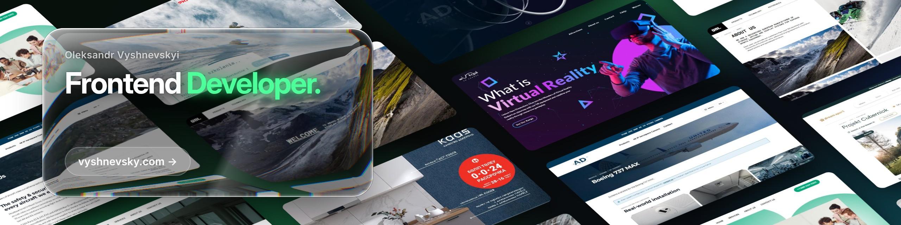
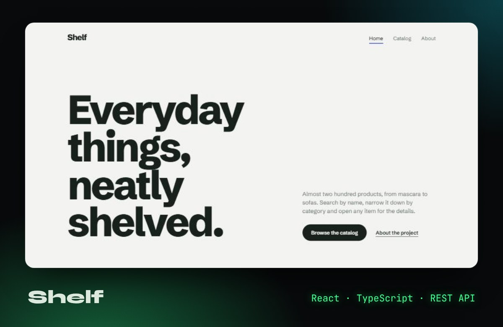
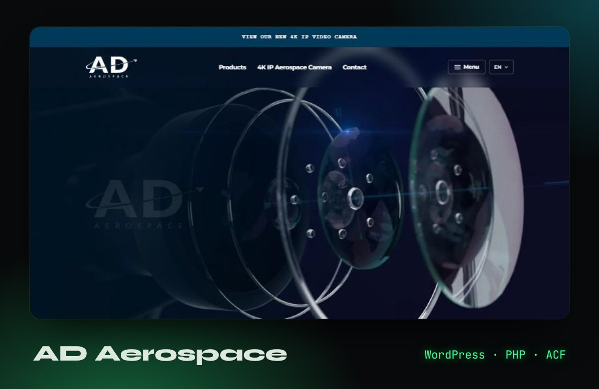
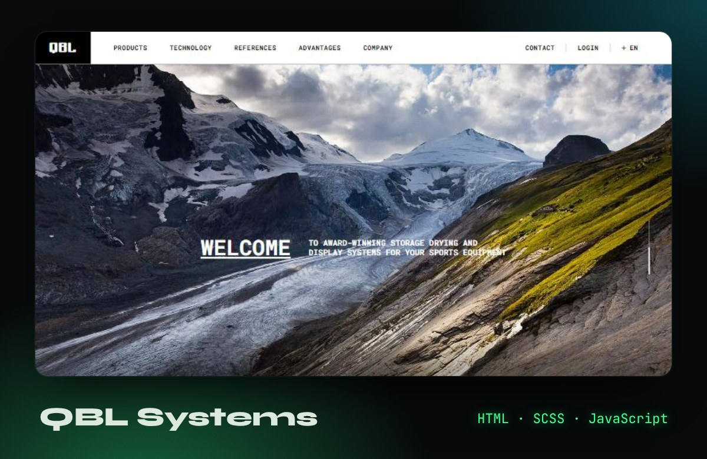
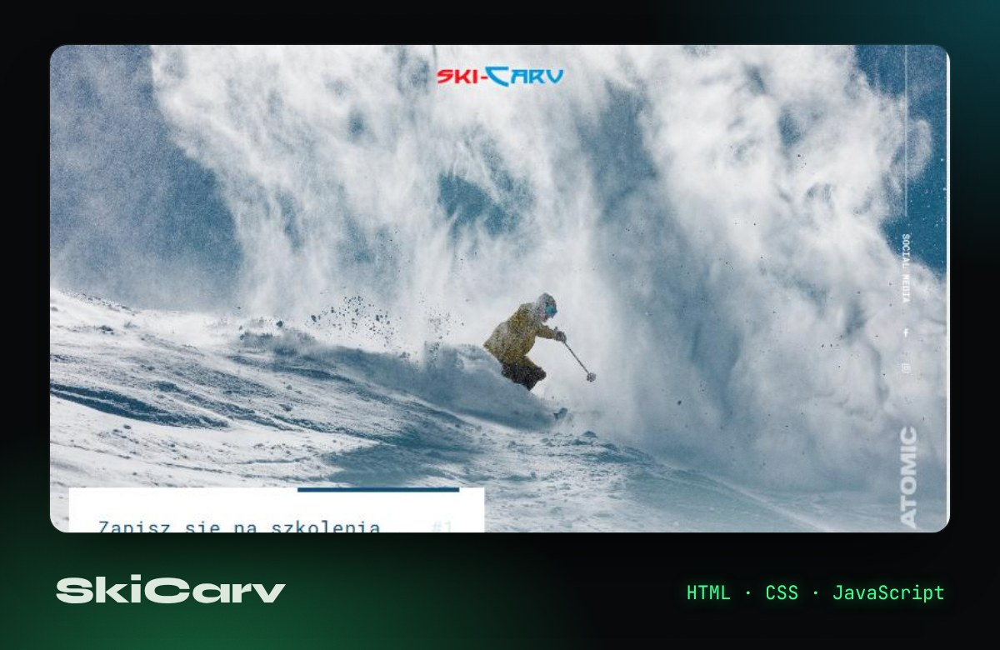

  

  

## About

Frontend developer building fast, responsive and accessible websites for clients worldwide since 2022.
I turn designs and ideas into clean, maintainable code, and I'm currently growing towards full-stack with **Next.js**.

## Stack

          

## Selected work

<table>
  <tr>
    <td width="50%">
      
      
<b><a href="https://react-product-catalog-ecru.vercel.app/">Shelf</a></b> · <a href="https://github.com/oleksandr-vyshnevskyi/react-product-catalog">code</a> Product catalog SPA with search, filters and product pages.

    </td>
    <td width="50%">
      
      
<b><a href="https://oleksandr-vyshnevskyi.github.io/AD-Aerospace-Redesign.github.io/">AD Aerospace</a></b> · <a href="https://github.com/oleksandr-vyshnevskyi/AD-Aerospace-Redesign.github.io">code</a> Full redesign and custom WordPress theme for an aerospace company.

    </td>
  </tr>
  <tr>
    <td width="50%">
      
      
<b><a href="https://oleksandr-vyshnevskyi.github.io/QBL.github.io/">QBL Systems</a></b> · <a href="https://github.com/oleksandr-vyshnevskyi/QBL.github.io">code</a> B2B company website with 20+ pages, built from an agency design.

    </td>
    <td width="50%">
      
      
<b><a href="https://oleksandr-vyshnevskyi.github.io/Ski-Carv.github.io/">SkiCarv</a></b> · <a href="https://github.com/oleksandr-vyshnevskyi/Ski-Carv.github.io">code</a> Ski school website with a trip cost calculator.

    </td>
  </tr>
</table>

<a href="https://vyshnevsky.com/projects.html">See all projects →</a>

## Contact

  
  
  

