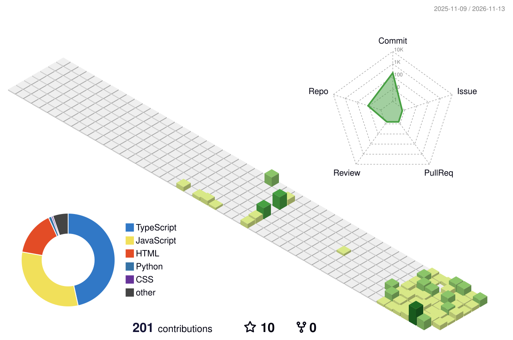

# Hi, I'm Oleksandr 👋

Frontend Developer from Rzeszów, Poland, building websites and web apps for clients worldwide since 2022.
Currently growing towards full-stack with **Next.js**.

### Tech stack

<picture>
  <source media="(prefers-color-scheme: dark)" srcset="./profile-3d-contrib/profile-night-green.svg" />
  
</picture>

### Selected work

- **[Shelf](https://github.com/oleksandr-vyshnevskyi/react-product-catalog)**: product catalog SPA in React + TypeScript with data from a REST API
- **[AD Aerospace](https://oleksandr-vyshnevskyi.github.io/AD-Aerospace-Redesign.github.io/)**: full website redesign and custom WordPress theme for an aerospace company
- **[QBL Systems](https://oleksandr-vyshnevskyi.github.io/QBL.github.io/)**: B2B company website with 20+ pages, built from an agency design
- **[SkiCarv](https://oleksandr-vyshnevskyi.github.io/Ski-Carv.github.io/)**: ski school website with a trip cost calculator

### Contact

[Portfolio](https://vyshnevsky.com) · [LinkedIn](https://linkedin.com/in/oleksandr-vyshnevskyi-dev) · [Email](mailto:oleksandr.vyshnevskyi.work@gmail.com)
